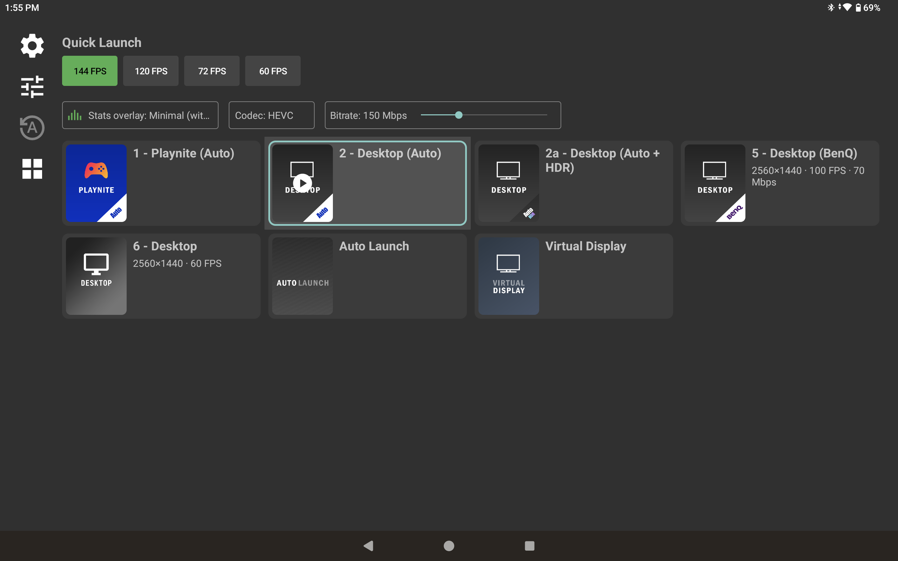
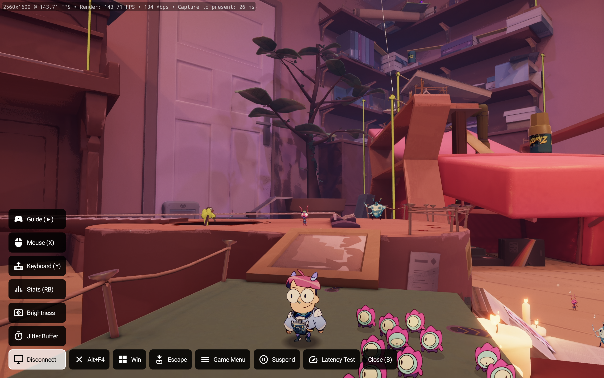
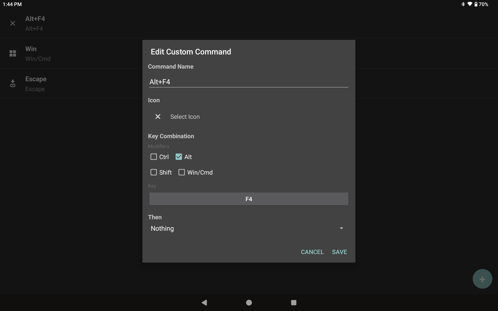
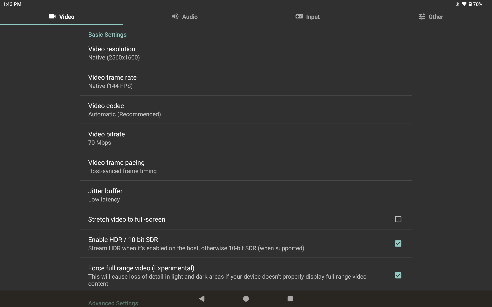
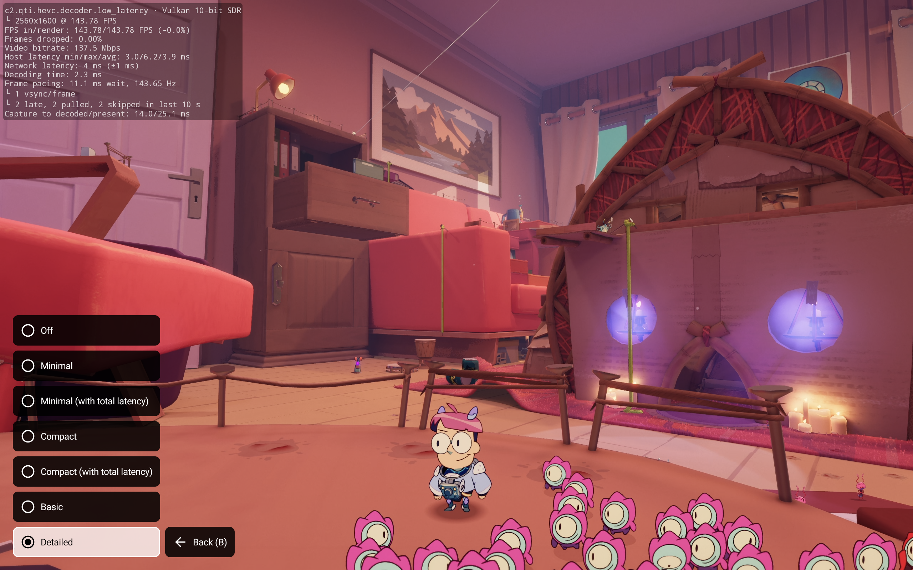

# Moonlight X

Moonlight X is a fork of [Moonlight for Android](https://github.com/moonlight-stream/moonlight-android), the open source client for [Sunshine](https://github.com/LizardByte/Sunshine). It builds on the original with new features, and with fixes and optimizations from [Artemis](https://github.com/ClassicOldSong/moonlight-android) and other developers.

It is the Android companion to [MoreOrLessSoftware Moonlight PC](https://github.com/MoreOrLessSoftware/moonlight-qt) and [MoreOrLessSoftware Sunshine](https://github.com/MoreOrLessSoftware/Sunshine). Some features are designed to work with that host, but it should work well with any Sunshine-compatible host. Where a feature needs the host's help, it is linked to the matching part of the Sunshine README.

Moonlight X installs next to the original Moonlight (its application ID ends in `.mlsoft`).

## New In This Fork

### Quick Launch Apps

Create shortcuts to specific apps on your PC and apply custom streaming settings (resolution, frame rate, bitrate and so on) to each one. The same app can have several shortcuts, each with a name of your choosing. They can be reordered, show whether they are running, can quit the session, and can be added as shortcuts in Android launchers.

### Per-App Settings and Overrides

Each app can have its own settings for resolution, frame rate, bitrate, codec, frame pacing, HDR, the jitter buffer and more, and apps that have them are marked with a gear. The app list has a card view that shows each app's overrides, and a PC's apps replace the PC list when you open it.

Quick overrides for the codec, bitrate (up to 2500 Mbps, with per-codec values and a Custom button) and performance stats, shown above the apps in the screenshot above, supersede any per-app or Quick Launch setting while they are on.

### Overlay Menu

A menu over the stream, opened by holding a gamepad button (Select, Start, Guide or LB + RB; the Back button of a remote always works), for a configurable time, with a 3-finger tap, or with a swipe in from the left edge.

- Disconnect, Quit Session (asks first), stats, mouse mode, the keyboard (except on Google TV), brightness, and the jitter buffer, changed while streaming.
- Custom commands: buttons that press key combinations on the host, with a post-action such as Sleep.
- Host commands: MoreOrLessSoftware Sunshine hosts can define their own [client commands](https://github.com/MoreOrLessSoftware/Sunshine/blob/mlsoft-custom/docs/client_commands.md), including groups for the program in the foreground, and commands added by [plugins](https://github.com/MoreOrLessSoftware/Sunshine/blob/mlsoft-custom/docs/plugins.md). They appear in the menu automatically.

Custom commands are set up in the settings with a name, an icon, modifier checkboxes and a key, and can do something afterwards, such as Sleep:

### Brightness

Swipe in from the left edge (or use the menu's Brightness button) to set a custom screen brightness while streaming, or slide it to the bottom for Auto, which uses the system brightness. The left edge swipe can instead open the overlay menu or be turned off.

### Vulkan Renderer and Frame Pacing

A Vulkan video renderer, with an experimental front buffer mode that draws just ahead of the display's scan-out, alongside the original Direct Surface renderer.

- **Host-synced frame timing**: frames are shown on the host's own capture cadence instead of the device's vsync alone. A learned schedule, with a jitter buffer of Balanced, Low latency, Lowest latency or Minimum (all changeable mid-stream), balances latency against smoothness. Works best with MoreOrLessSoftware Sunshine, which [captures frames as soon as the desktop presents them](https://github.com/MoreOrLessSoftware/Sunshine#latency-and-frame-pacing).
- An Instant jitter buffer shows each frame as soon as it is decoded.
- The device's display refresh rate is measured and a matching frame rate is requested from the host (to the microhertz), with a warning before streaming at a rate the display can't pace evenly.
- Custom resolutions and frame rates replace the Unlock FPS option.
- Recovery from a decoder that drops frames or stops handing them out.

### PyroWave

Support for [PyroWave](https://github.com/Themaister/pyrowave), an experimental wavelet codec for very low latency at very high bitrates on a wired LAN, decoded in Vulkan compute on devices with Vulkan 1.1. Requires a host that can encode PyroWave, such as [MoreOrLessSoftware Sunshine](https://github.com/MoreOrLessSoftware/Sunshine#pyrowave) (Windows only). Frames that lost packets, or that are still arriving at their deadline, are shown partly decoded rather than dropped (Off, Balanced or Smoother). An optional GPU boost keeps the GPU's clock up between frames.

### Performance Stats

- Stats modes from Minimal and Basic to a compact one-line view and a detailed one, picked from the overlay menu, with capture to decoded and capture to present latency (using the host's clock, which [Sunshine answers sync requests for](https://github.com/MoreOrLessSoftware/Sunshine#latency-and-frame-pacing)), bitrate measured from the video socket, and frame rate variance.
- Decode times to one decimal place, and late, pulled and skipped frames on their own line.
- The stream's settings, negotiated codec and pacing shown as toasts once connected.
- Pacer traces, with unattended runs from Quick Launch presets, for analyzing latency against Sunshine's [per-frame trace and CSV](https://github.com/MoreOrLessSoftware/Sunshine#latency-and-frame-pacing).

### Decoders and HDR

- Vendor low-latency decoder flags, on by default, for Snapdragon (8 Gen 2+), Exynos, Amlogic and MediaTek, plus Pixel 10 and Tegra fixes. Merged from Artemis, with their revised decode latency calculation (typically a few ms less than Moonlight reports).
- Force HDR (10-bit SDR) streaming on devices that don't support HDR, bypassing the HEVC decoder check when HDR is enabled. Experimental.

### Other

- Settings are split into Video, Audio, Input and Other tabs, which a controller's shoulder buttons switch between, and show each setting's current value.
- A bitrate recommendation instead of a forced change, aware of PyroWave's needs.
- An error correction (FEC) setting chooses how much FEC the host sends: the host's setting, off, or a custom percentage, and a video send rate setting does the same for how fast it sends each frame's packets (both need [a compatible host](https://github.com/MoreOrLessSoftware/Sunshine#error-correction)).
- An option to ask the host to encode with exactly the slices the device's decoder wants.
- Auto-resume a stream after the device sleeps.
- The device's name is sent as the device name when pairing.
- The running app's box art is bordered in the accent color.

## Downloads

[Download the APK from releases](https://github.com/MoreOrLessSoftware/moonlight-android/releases)

## Building

See instructions from the base repository: https://github.com/moonlight-stream/moonlight-android#building

## Credits

Moonlight X is a fork of the original [Moonlight Android](https://github.com/moonlight-stream/moonlight-android) which is authored by [Cameron Gutman](https://github.com/cgutman) and others.
